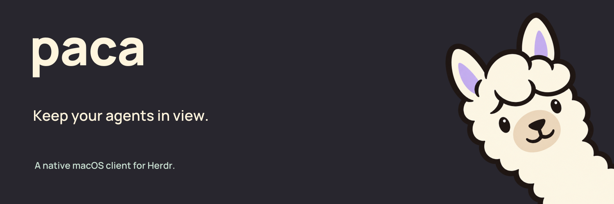

# Paca



[](https://github.com/adarshzpatel/paca/actions/workflows/ci.yml)
[](LICENSE)

Native macOS client for [herdr](https://herdr.dev). Slack-style window plus a menu bar item that tracks your coding agents. See [docs/PLAN.md](docs/PLAN.md).

Status: early (M0). Expect rough edges and breaking changes. Codex-style window (rail, sidebar, live terminal, prompt card), menu bar item with the alpaca symbol, Base16 themes that match herdr (Settings, ⌘,).

## Requirements

- macOS 14+
- Swift 6 toolchain (Command Line Tools is enough)
- Xcode 26+ to package the native layered app icon with `scripts/install.sh`
- herdr 0.9+ installed. Paca starts a headless server if none is running

## Install

```bash
git clone https://github.com/adarshzpatel/paca.git
cd paca
scripts/run.sh            # build and run from source
scripts/install.sh        # or build Paca.app into /Applications (needs Xcode 26)
```

There are no signed release builds yet.

## Scripts

| Command | What it does |
|---|---|
| `scripts/run.sh` | Build and launch Paca against your default herdr session |
| `scripts/run.sh --session paca-test --select w1:p1` | Launch against a named session with a pane open |
| `scripts/probe.sh` | Print workspaces, panes and status without the GUI |
| `scripts/probe.sh watch` | Stream live herdr events |
| `scripts/probe.sh frame w1:p1` | Attach to a pane, print the first frame, release |
| `scripts/test-session.sh start` / `stop` | Throwaway `paca-test` herdr server for experiments |
| `scripts/test.sh` | Unit tests (works without Xcode) |
| `scripts/snapshot.sh out.png [--session NAME --select PANE] [--window-size WxH] [--click X,Y [--keys SPEC] [--scroll LINES]]` | Render the window to a PNG, no Screen Recording permission needed. `--click` first sends a real click at X,Y (points from the window's top-left) to check a control responds |
| `scripts/install.sh [DIR]` | Build a release `Paca.app` and install it to `/Applications` (or `DIR`), replacing the running copy |
| `scripts/contrast.sh [--all] [--increased]` | WCAG contrast audit of every theme as Paca draws it; exits 1 if anything fails |
| `scripts/sync-brand.sh` | Copy brand assets into the app and compile the native icon plus its ICNS fallback, requires Xcode 26+ |
| `scripts/build-app-icon.sh [DIR]` | Compile `brand/app-icons/Paca.icon` into `Assets.car`, `Paca.icns`, and icon metadata |
| `scripts/render-app-icon.sh` | Render light, dark, clear, tinted and Dock-size previews with Icon Composer |

Set `PACA_DEBUG=1` to trace attach, resize and frame events to stderr.

## App icon

`brand/app-icons/Paca.icon` is the editable Icon Composer source. It keeps the
original transparent alpaca separate from the lavender background. Apple renders
the gradient, material highlights, shadow and appearance variants.

`scripts/install.sh` compiles it into `Assets.car` and an ICNS fallback for macOS
14 and 15, then sets `CFBundleIconName` to `Paca`. Installed builds leave icon
rendering to macOS; bare `swift run` builds use the static fallback. Do not replace
the installed app's `applicationIconImage`, which discards the native layers.

The compiler requires full Xcode 26 or later. The build script uses
`/Applications/Xcode.app` when Command Line Tools is selected, without changing
the system's selected developer tools. For a different location, set
`DEVELOPER_DIR=/path/to/Xcode.app/Contents/Developer` for the command. Icon Composer
alone can render previews but cannot compile the app's asset catalog.

## Layout

- `Sources/HerdrKit` socket client, models, terminal control bridge
- `Sources/Paca` SwiftUI app (store, sidebar, SwiftTerm view, menu bar)
- `Sources/paca-probe` CLI smoke check

## Themes

Paca uses Base16 schemes. One scheme colors the window chrome and the terminal's 16 ANSI colors, so agent output and the UI always match.

- **Match herdr** (default) reads `[theme]` from `~/.config/herdr/config.toml`, including `auto_switch` with `dark_name` / `light_name`, and picks the same theme.
- **Match System** uses Paca Light or Paca Dark with macOS.
- **Match Ghostty** reads `ghostty +show-config` and uses Ghostty's exact background, foreground, cursor and 16 ANSI colors. The terminal font also follows Ghostty (family, size, weight) unless Settings says otherwise, and Ghostty `keybind = …=text:…` entries (like `shift+enter=text:\n`) work in Paca's terminal.
- Built in: Paca Dark, Paca Light, and every herdr theme: Catppuccin Mocha and Latte, Tokyo Night, Dracula, Nord, Gruvbox Dark and Light, One Dark, Solarized Dark and Light, Kanagawa, Rosé Pine, Vesper.
- Add your own: put a Base16 `.yaml` file (classic `base00: "1d1f21"` or tinted-theming `palette:` format) in `~/.config/paca/themes/`. Paca reloads the folder when it comes to the front.

Pick a theme from the palette button in the top bar or in Settings (⌘,). For scripted runs, `--theme ID` (for example `--theme tokyo-night` or `--theme user:github-dark`) applies a theme for that launch without saving it.

### Contrast and accessibility

Themes are corrected, not just copied. `PacaTheme` derives every UI and terminal color from the scheme, then moves any color that misses its WCAG minimum toward white (dark themes) or black (light themes), only as far as needed:

| Pairing | Minimum | With macOS Increase contrast |
|---|---|---|
| Primary text | 7:1 | 7:1 |
| Secondary text, status and accent colors | 4.5:1 | 7:1 |
| Faint hints and icons | 3:1 | 4.5:1 |
| Terminal foreground and ANSI 1–15 (including dim "bright black") | 4.5:1 | 7:1 |
| Selected terminal text | 4.5:1 | 7:1 |

`swift test` fails if a built-in theme misses any minimum. Run `scripts/contrast.sh` to see what was corrected per theme. Colors a program sets directly (24-bit escape codes) aren't changed.

The working spinner stops spinning with Reduce motion on, tabs have VoiceOver labels and actions, and ⌘1 to ⌘9 switch tabs.

### Tabs and splits

- Every pane you open becomes a tab with its workspace shown as a pill (the dot color is per workspace and never a status color). ⌘1 to ⌘9 switch tabs.
- ⌘D splits right, ⌘⇧D splits down, the same key again closes the split (also the split button in the top bar). The new side shows your previous tab, or a picker if there isn't one.
- Click a side, or pick its tab, to focus it; the focused side has an accent outline. Drag the divider to resize. A split header's × takes that pane out of the split and leaves its tab open.

### Terminal

- Keys follow your Ghostty config (or Ghostty's defaults without Ghostty): `text:` keybinds, `jump_to_prompt` (⌘↑/⌘↓, ⌘⇧↑/⌘⇧↓ jump between prompts in herdr's scrollback; Paca recognises `❯ $ %` shell prompts, Claude's `>` and Codex's `›`), `scroll_to_top`/`scroll_to_bottom` (⌘Home/⌘End) and page scrolling. Unbound ⌘ + arrow combinations (⌘⇧←, ⌘⇧→ …) are sent to the program the way Ghostty sends them, `ESC[1;{mod}{A–D}`.
- Mac line editing works like Terminal.app and Ghostty: ⌘← / ⌘→ jump to line start / end, ⌘⌫ deletes to line start, ⌘⌦ to line end. ⌥ word movement is unchanged.
- Scrolling (wheel or trackpad) moves through herdr's scrollback, the pane's full history, not just what Paca has seen. Typing jumps back to the bottom. Apps that track the mouse, like vim with mouse mode, get the wheel themselves.
- Performance: hidden tabs stay attached but pause (their output isn't parsed or drawn; showing the tab requests one full repaint). A streaming pane redraws at most 30 times a second (15 when it's the unfocused side of a split), and frames right after a keystroke skip that limit so echo is immediate. Scrolling sends one command per display frame. `PACA_DEBUG=1` logs keystroke latency and main-thread stalls; `PACA_NO_PAUSE=1` and `PACA_FRAME_MS=N` exist for A/B measurements.
- Terminals render with Metal by default (about 6× less time per frame than CoreGraphics). Settings can turn it off.
- Paca attaches to a pane once, at its final size, and keeps open tabs attached. Every size change makes agents like Claude Code redraw and can leave stale lines, so Paca avoids them; resizes from window or sidebar drags are debounced.

## Contributing

Bug reports and pull requests are welcome. Start with [CONTRIBUTING.md](CONTRIBUTING.md). Report security bugs privately, as described in [SECURITY.md](SECURITY.md). Everyone follows the [Code of Conduct](CODE_OF_CONDUCT.md).

## License

The code is [MIT](LICENSE) licensed. The Paca name, logo, mascot and app icon are not covered by the MIT license; see [TRADEMARKS.md](TRADEMARKS.md). Bundled fonts and icons keep their own licenses, listed in [THIRD_PARTY_NOTICES.md](THIRD_PARTY_NOTICES.md).

Paca is an independent project and isn't affiliated with herdr.
